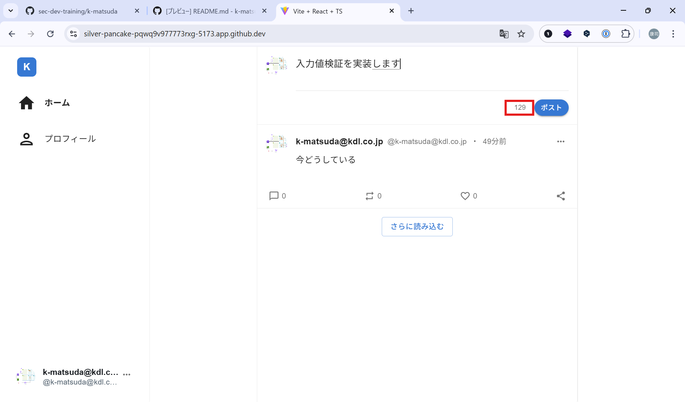
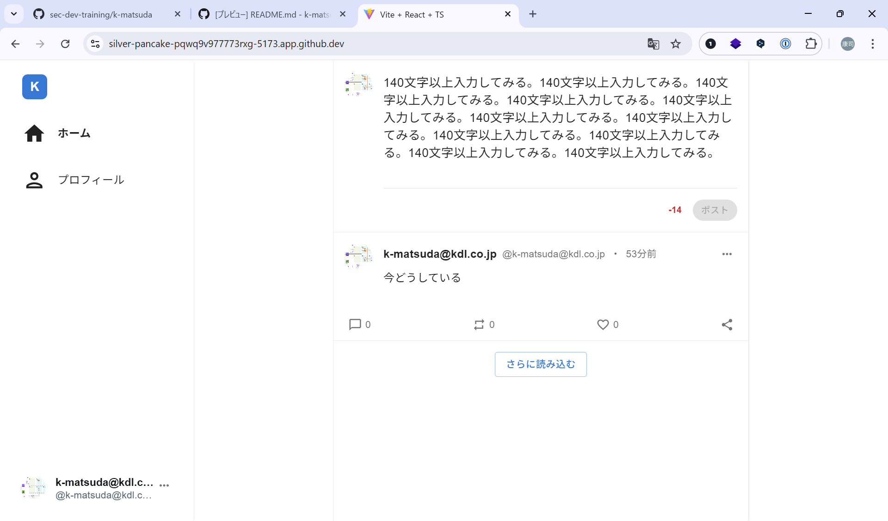
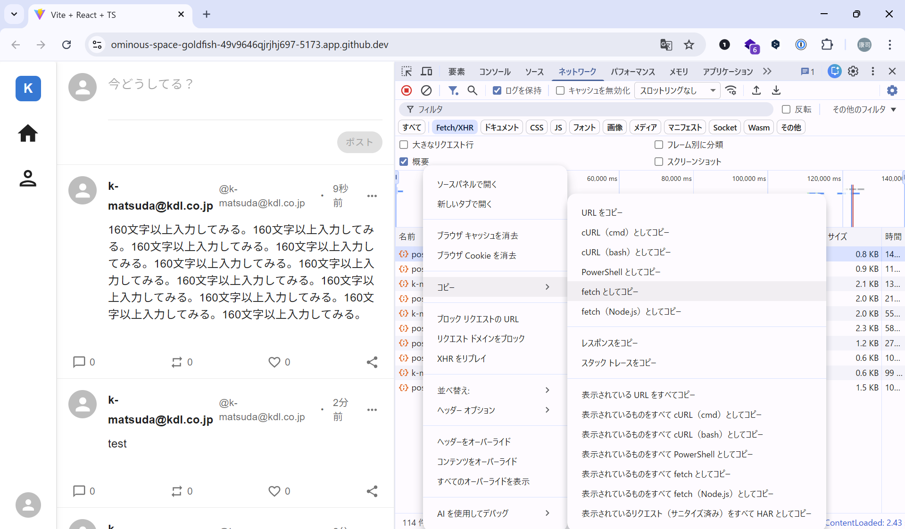
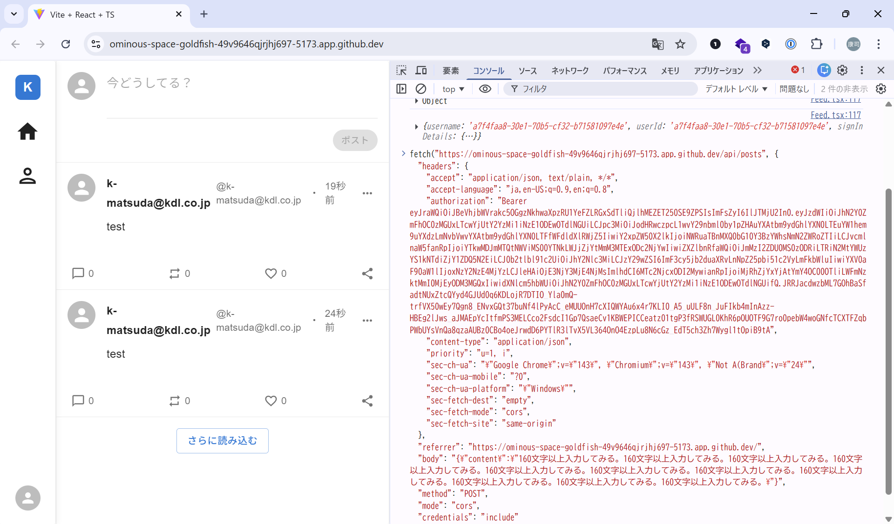
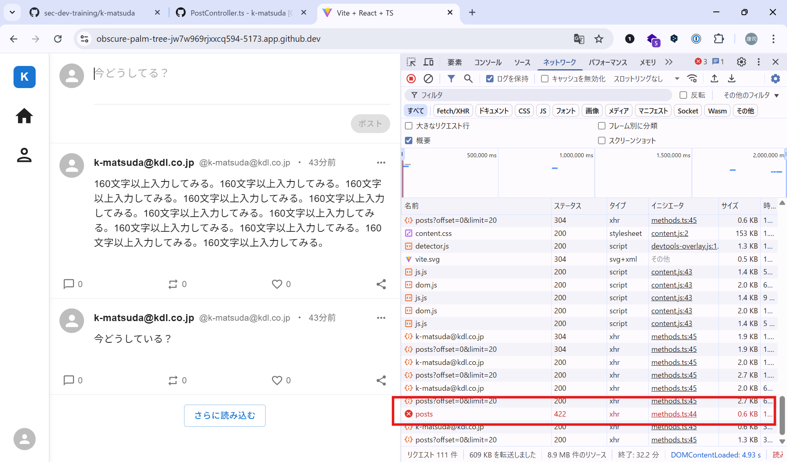
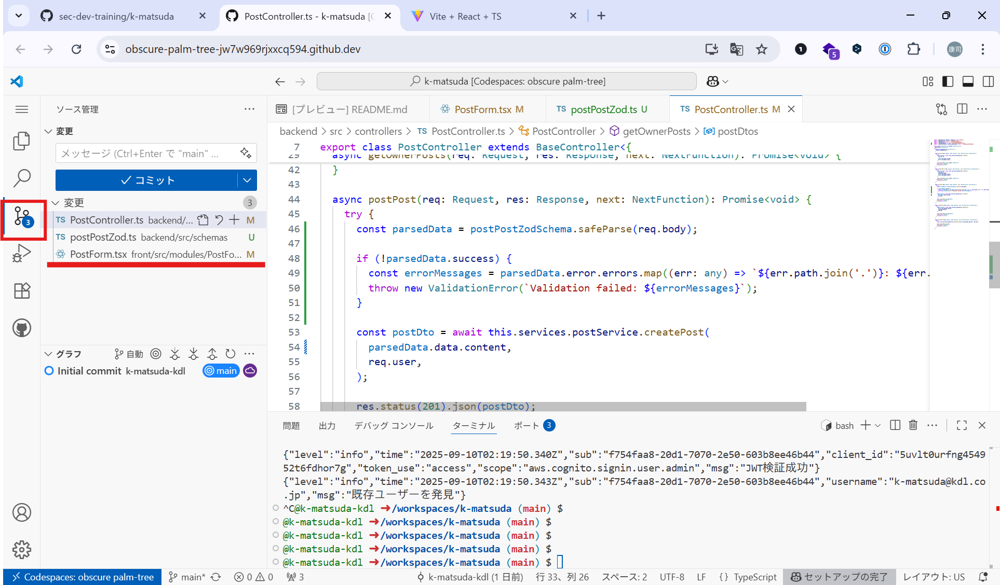
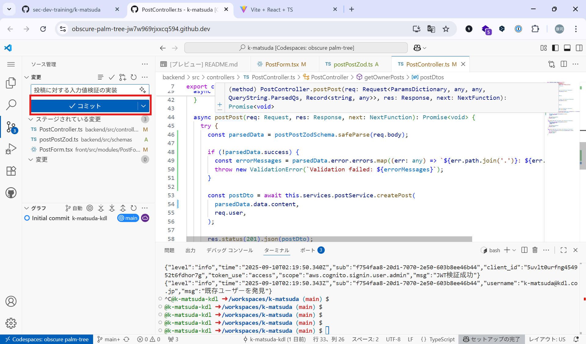

# 入力値検証
この章では、入力値検証を実装します。以下のポイントに沿って、入力値検証を実装してみましょう。

## ポイント
- まず初めてにホワイトリストで検証できないか確認する
  - ホワイトリストで検証できる場合は、ホワイトリストで検証する
- ホワイトリストで検証でない場合、以下で検証する
  - サイズ
  - 文字種
  - フォーマット
  - 意味的検証


## 投稿（POST /api/posts）に対して入力値検証を実装する
まず、現在の状況を確認します。

1. Codespacesで`backend/src/controllers/PostController.ts:42`を見てみましょう。

    POST /api/posts リクエストを受けつけるコントローラである、`postPost`メソッドにて、入力値検証がありません。ここに入力値検証がほしいです

``` typescript
  async postPost(req: Request, res: Response, next: NextFunction): Promise<void> {
    try {
      const postDto = await this.services.postService.createPost(
        req.body.content,
        req.user,
      );

      res.status(201).json(postDto);
    } catch (err: unknown) {
      next(err as Error);
    }
  }
```

2. 実際にブラウザから投稿を入力してみると、フロント画面の制御により文字数に制限がかかっていそうです。



以下の文字を入力してみます。おそらく154文字入力されています。


```
140文字以上入力してみる。140文字以上入力してみる。140文字以上入力してみる。140文字以上入力してみる。140文字以上入力してみる。140文字以上入力してみる。140文字以上入力してみる。140文字以上入力してみる。140文字以上入力してみる。140文字以上入力してみる。140文字以上入力してみる。
```

以下のように140文字を超えると`ポスト`ボタンが押せません



しかし、これはフロントのみの制御であり、API側では制御されていません。試してみます。

`front/src/modules/PostForm/PostForm.tsx`を見てみます。`maxLength`のデフォルトが140文字なっているので、`160`文字に変えてみます。

### frontのコードを変更する
Codespacesのコードを変更すると、コードを変更することができます。今回のサービスは、コードを変更すると自動的に反映されるようになっています。

1. Codespacesで`front/src/modules/PostForm/PostForm.tsx:47`を開く

``` typescript
export const PostForm: React.FC<PostFormProps> = ({
  userAvatar,
  onSubmit,
  maxLength = 160, // 160文字に変更する
}) => {
  // 投稿内容を管理するstate
  const [content, setContent] = useState("");
```

> [!NOTE]   
> Ctrl + p でファイル名やパスを入力するとそのファイルを開くことができます。操作方法は、VSCodeとほぼ同じです。 

2. サービスにアクセスして、160文字でも入力できることを確認します。以下を入力して投稿してみます。（154文字です。）

```
160文字以上入力してみる。160文字以上入力してみる。160文字以上入力してみる。160文字以上入力してみる。160文字以上入力してみる。160文字以上入力してみる。160文字以上入力してみる。160文字以上入力してみる。160文字以上入力してみる。160文字以上入力してみる。160文字以上入力してみる。
```

無事入力できました。API側には入力値検証がないことがわかりましたので、入力値検証を実装してみます。

つぎは、フロントを変えずにやってみましょう。

#### 検証ツールでリクエストを再現する

アプリケーションにChromeでアクセスして、Chromeの開発者ツールを開きます（F12もしくは、右クリックして`検証`を選択します）。

ネットワークタブを開いて、先ほどのリクエストを探しまて右クリックを押します。おそらく `fetch/XHR`ボタンで絞り込んで、`posts` と書かれたものがそれです。POST /api/posts を探してください。

右クリック->コピー->fetchとしてコピーをクリックします。



次にコンソールタブを開いて、Ctrl+vで貼り付けてください



最後にEnterを押すと、リクエストが飛びます。再びネットワークタブを開いて、リクエストが増えていることを確認してください。200 が返っていれば成功です。


#### backendに入力値検証を実装する

このトレーニングでは、[Zod](https://zod.dev/)ライブラリを使ってみます。Zodは、Typescriptで動作するvalidationライブラリです。frontでもbackendでも使えるので非常に便利に使えます。

既に、zodはインストールされていますので、とりあえず使ってみましょう

1. `backend/src/schemas/postPostZod.ts`を開きます。以下のように特に何も指定されていません。

``` typescript
import { z } from 'zod';

export const postPostSchema = z.object({
});

export type PostPostSchema = z.infer<typeof postPostSchema>;
```

2. ここにvalidationを追加します。ホワイトリストは採用できませんので、以下の項目を検証します。

- サイズ :140文字以内
- 文字種 :文字列および改行を含む印字可能な文字
- フォーマット :特に指定なし
- 意味的検証 :特に指定なし

``` typescript
import { z } from 'zod';

export const postPostSchema = z.object({ // 入力全体がオブジェクトであること
  content: z.string() // contentプロパティが文字列であること
    .min(1, 'Content must not be empty') // 1文字から
    .max(140, 'Content must not exceed 140 characters') // 140文字以内であること
    .regex(/^[\p{L}\p{M}\p{N}\p{P}\p{S}\p{Z}\n\r]*$/u, 'Content contains invalid characters')
    // 改行コードを含む印字可能な文字のみを許可
});

export type PostPostSchema = z.infer<typeof postPostSchema>;
```

※validation内容は、[OpenAPI](./openapi.yml)にも記載しました。

3. さらに、`postPost`メソッドでvalidationを実行します。`backend/src/controllers/PostController.ts:42`を開きます

``` typescript
import { ValidationError } from '../errors/ValidationError'; // 追加
import { postPostSchema as postPostZodSchema } from '../schemas/postPostZod'; // 追加

  async postPost(req: Request, res: Response, next: NextFunction): Promise<void> {
    try {
      const parsedData = postPostZodSchema.safeParse(req.body); // validationを実行

      if (!parsedData.success) { // エラーがあれば、ValidationErrorの例外をthrowします
        const errorMessages = parsedData.error.errors.map((err: any) => `${err.path.join('.')}: ${err.message}`).join(', ');
        throw new ValidationError(`Validation failed: ${errorMessages}`);
      }

      const postDto = await this.services.postService.createPost(
        parsedData.data.content, // validation済みの値を使うことで、確実にvalidationを有効にします
        req.user,
      );
```

> [!NOTE]   
> このbackendのコードでは、`backend/src/middlewares/global/errorHandler.ts`でエラーをハンドリングしています。各種例外が発生したときのレスポンスコードやログへの追記は、この処理で実装しています。 

4. エラーになるか試してみます。サービスにアクセスして、160文字でも入力した場合、`422`のエラーになることを確認します。以下を入力して投稿してみます。（154文字です。）

```
160文字以上入力してみる。160文字以上入力してみる。160文字以上入力してみる。160文字以上入力してみる。160文字以上入力してみる。160文字以上入力してみる。160文字以上入力してみる。160文字以上入力してみる。160文字以上入力してみる。160文字以上入力してみる。160文字以上入力してみる。
```

無事エラーになりました。



#### ここまでの変更をgithubに反映します
Codespacesにはgitがついてますので、そのまま反映することが可能です。今回は、ブランチを変更せずに`main`ブランチをそのまま使いますが、お好みに合わせて、ブランチを変更して作業してください。

1. Codespacesのgitにアクセスします。変更の横の`+`をクリックして、ステージングに加えます。



2. コミットメッセージを入れて`commit`します



3. `main`ブランチにpushします

-----
## 課題:GET /api/posts/<username>の入力値検証
もちろん`GET`メソッドでも入力値検証は必要です。`GET /api/posts/<username>`エンドポイントでは、指定されたusernameの投稿を取得します。`limit`と`offset`にて、件数と開始位置をそれぞれ数字で指定します。

`docs/openapi.yml`に簡単な仕様を掲載していますので、確認して実装してください。

<details><summary>回答例</summary>

`backend/src/schemas/getOwnerPostsZod.ts`

``` typescript
import { z } from 'zod';

export const getOwnerPostsSchema = z.object({
  owner: z.string()
    .min(1, 'Owner must not be empty')
    .max(128, 'Owner must not exceed 128 characters')
    .regex(/^[\p{L}\p{M}\p{N}\p{P}\p{S}\p{Z}]*$/u, 'Owner contains invalid characters'),
  offset: z.number()
    .min(1, 'Offset must be greater than or equal to 0')
    .max(65536, 'Offset must not exceed 65536')
    .optional(),
  limit: z.number()
    .min(1, 'Limit must be greater than or equal to 0')
    .max(20, 'Limit must not exceed 20')
    .optional()
});

export type GetOwnerPostsSchema = z.infer<typeof getOwnerPostsSchema>;
```

`backend/src/controllers/PostController.ts:27`

``` typescript
import { getOwnerPostsSchema as getOwnerPostsZodSchema } from '../schemas/getOwnerPostsZod';

  async getOwnerPosts(req: Request, res: Response, next: NextFunction): Promise<void> {
    try {
      const parsedData = getOwnerPostsZodSchema.safeParse({
        owner: req.params.owner,
        offset: req.query.offset ? Number(req.query.offset) : undefined,
        limit: req.query.limit ? Number(req.query.limit) : undefined,
      });

      if (!parsedData.success) {
        const errorMessages = parsedData.error.errors.map((err: any) => `${err.path.join('.')}: ${err.message}`).join(', ');
        throw new ValidationError(`Validation failed: ${errorMessages}`);
      }

      const postDtos = await this.services.postService.findPosts(
        req.user.id,
        parsedData.data.owner,
        parsedData.data.offset,
        parsedData.data.limit,
      );

      res.status(200).json({ Items: postDtos });
    } catch (err: unknown) {
      next(err as Error);
    }
  }

```

</details>


