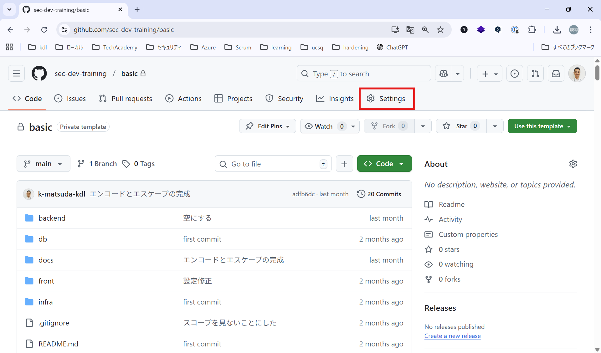
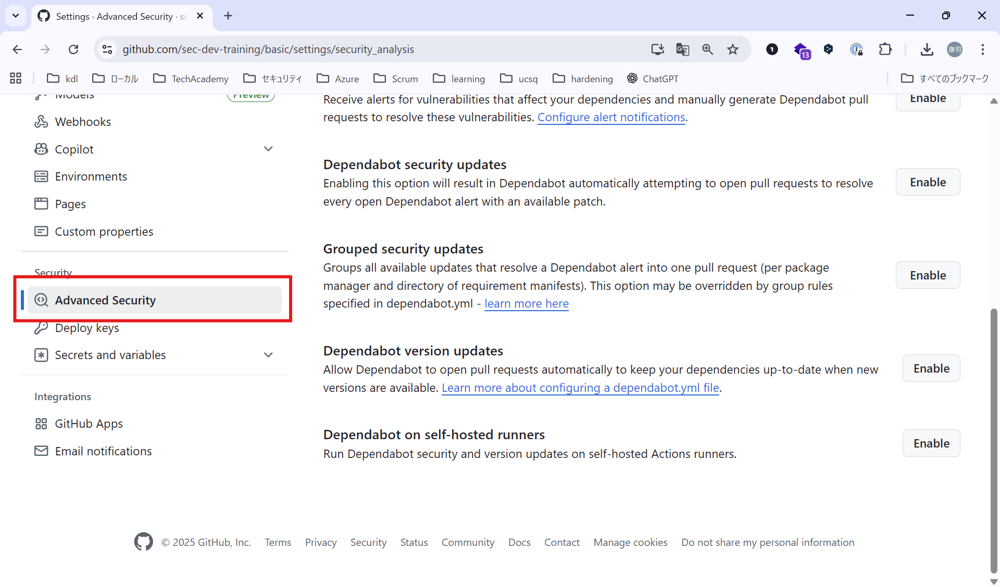
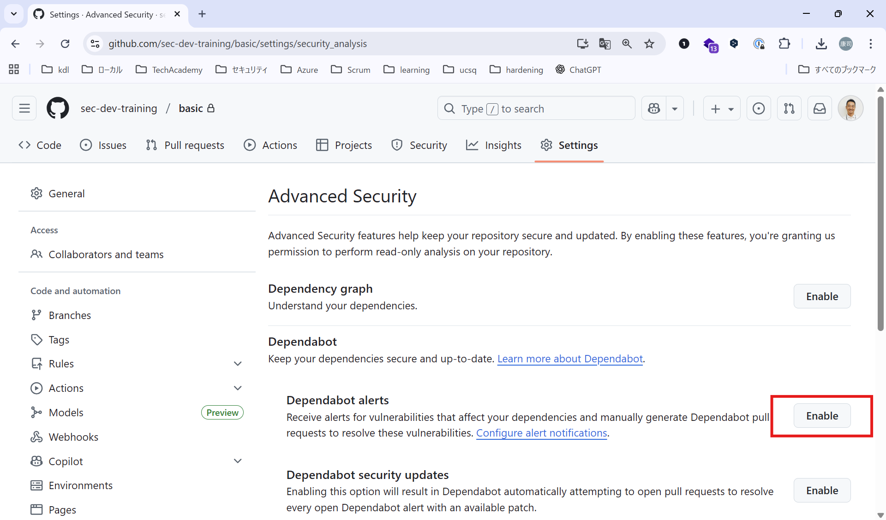
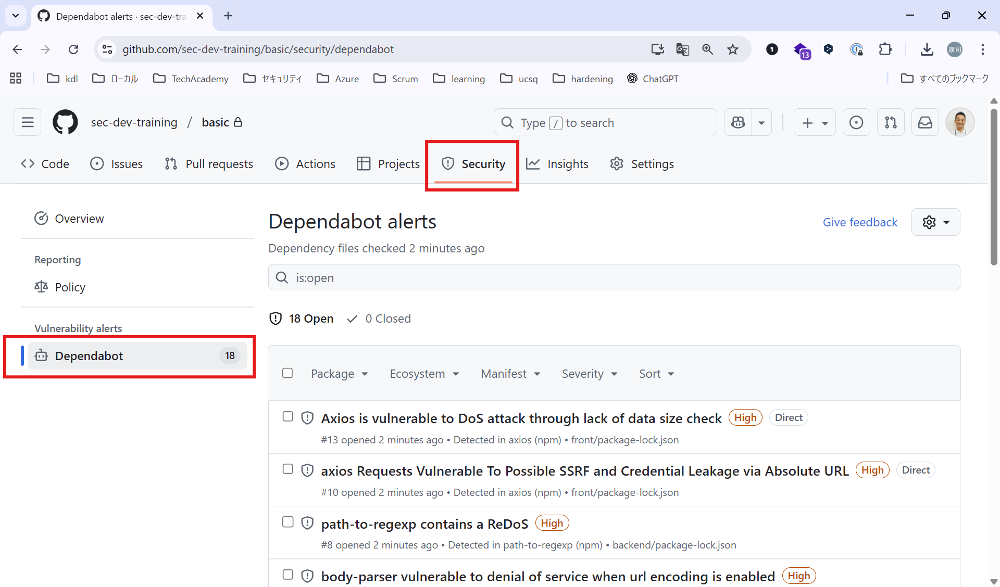
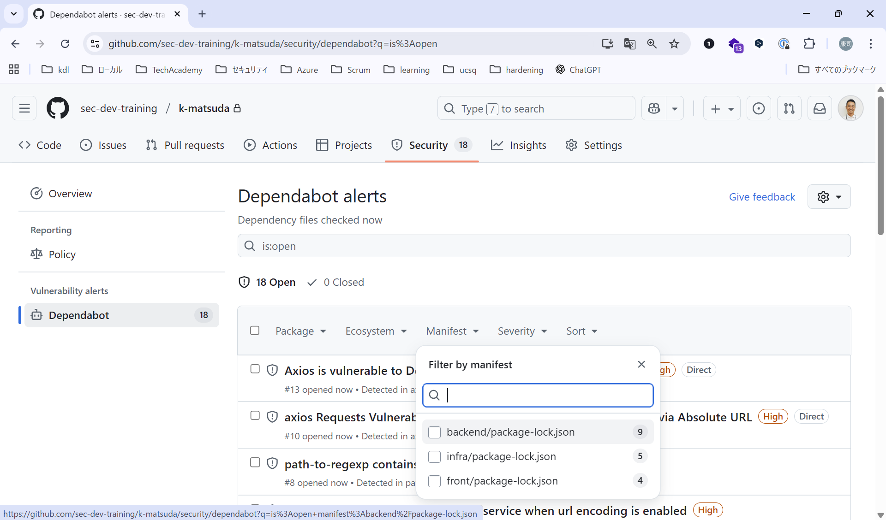
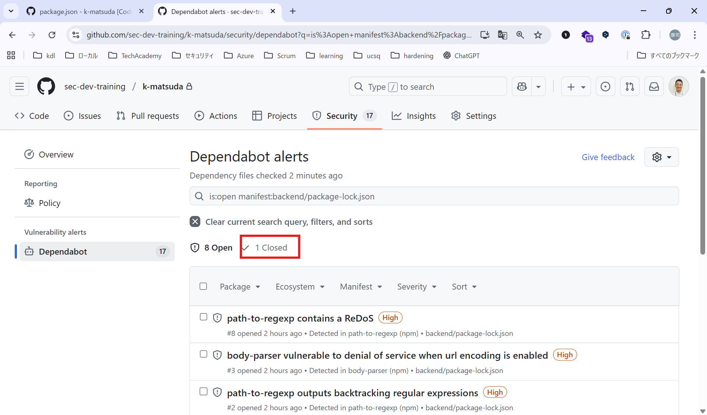
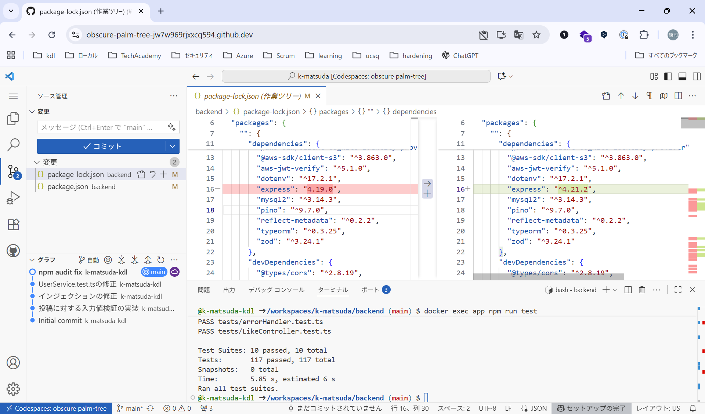
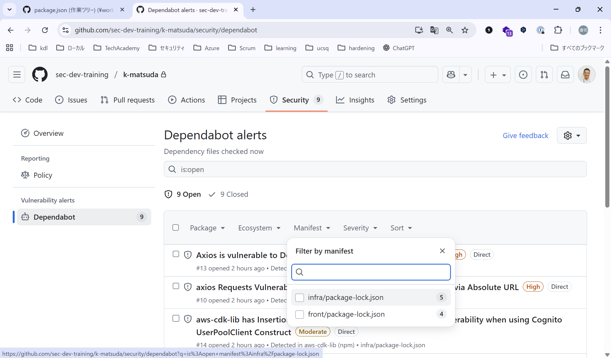

# サードパーティ製コンポーネントの脆弱性
この章では、サードパーティ製コンポーネントの脆弱性を修正します。

まずは、脆弱性を可視化してみましょう。このトレーニングでは、GitHubのDependabotを活用してみます

## Dependabotを活用する
まずは、Dependabot alertsをONにしてみます。Freeプランのプライベートリポジトリでも活用いただけます。（2025年10月現在）

リポジトリの `Settings` の `Advanced Security` にアクセスします。





Dependabot alertsを `Enabled` にしてみます。



### 脆弱性を確認する
`Security` の `Dependabot` を確認します。件数や内容が画面と違うと思いますが、脆弱性は随時発見されておりますので、内容は異なります。



このトレーニングのリポジトリは、モノレポになっており、`front` `backend`の全てが一つのリポジトリに入ってます。まずは、`backend` を確認してみます。

絞り込み機能を利用して、`Manifest` から `backend/package.json` を選択します



いくつか見つかっているかと思います。細かい危険度は一旦無視して、修正してしまいましょう。GitHub の Dependabot を使えば、修正した Pull Request まで出せますが、このトレーニングでは、手動でやってみます。

`Code Spaces`に移動して、サービスを起動してください(`docker compose up -d`コマンドで起動できると思います)

### ローカルでアップデートする
まずは、ローカルで脆弱性を確認します。

``` bash
cd backend/
npm audit
```

`npm audit`コマンドは、npmをベースに脆弱性を検査するコマンドです。`fix`オプションや`fix --force`オプションで修正まで行えます。

では、修正を・・・の前にテストを実行します。

``` bash
docker exec app npm run test
```

結果は以下のように、全てPASSすると思います。

``` bash
Test Suites: 10 passed, 10 total
Tests:       117 passed, 117 total
Snapshots:   0 total
Time:        6.19 s, estimated 12 s
Ran all test suites.
```

もちろんアップデートすると、システムにエラーが出る可能性があります。必ず、アップデート前後でテストを実施して動作に問題がないかを確認しましょう。その際に、テストコードがあると早く確認できるので便利です。

アップデートには、`npm audit fix`コマンドを利用します。fixコマンドは、互換性のある範囲（セマンティックバージョニングでのマイナーバージョン・パッチ）に収まる更新だけを適用します。つまり、既存の依存関係の互換性を壊さない安全な更新のみを実行します。

``` bash
cd backend/
npm audit fix
```

いくつか減りましたか？互換性のある範囲のみのアップデートで修正される範囲だけが修正されたかと思います。ただし、いくつか残っていると思います。ここまでで、テストを実施して問題ないことを確認し、GitHubにpushしましょう。

``` bash
docker exec app npm run test
```

GitHubにpushしたら、Dependabotで確認してみます。このときは、1件Closeされたみたいです。




次に、互換性を無視してアップデートします。

``` bash
npm audit fix --force
```

`--force`オプションを使うと、互換性を無視して脆弱性の発見されていないバージョンにアップデートします。必ずpackage.jsonの内容を確認して差分を確認しましょう。

expressのバージョンが変わっていませんか？（このトレーニングでは、敢えてexpressの脆弱性のある4.19.0で固定されていました）



では、最後にテストを実施して問題なければ、GitHubにpushします

``` bash
docker exec app npm run test
```

Dependabotを確認すると、`backend/package.json`の脆弱性が消えていました



## End of Life (EoL)に対応する
End of Life(以下、EoL)とは、ソフトウェアやシステムがメーカーや開発元によるサポートを終了する時期を指します。つまり、その日以降はアップデートや修正が行われなくなるということです。例えば、Windows 10 のサポートは 2025年10月14日 に終了予定です。これ以降、セキュリティ更新が提供されません。

そのため、EoLを過ぎて使い続けた場合、脆弱性が発見されてもパッチが提供されない可能性があります。また、脆弱性が公表されない場合もあり、知らないうちに危険になっていることも考えられますので、必ずEoLを過ぎたパッケージ、ランタイムを使わないようにしましょう。

とはいえ、依存関係に含まれるパッケージも含めてすべてEoLを管理するのは現実的ではなく、また、パッケージによっては最新バージョンのみ（つまり、アップデートがあればすぐにEoLになる）のようなパッケージも存在します。そのため、以下の主要なコンポーネントに限定して管理するのをお勧めします。

- OS(Ubuntu、Debianなど)
- ミドルウェア(Apache, MySQLなど)
- ランタイム(Python, PHP, Nodejs, Javaなど)
- フレームワーク(Django, React, Laravelなど)
- その他コンポーネント(Redis, Keycloakなど)

### EoLに対応する
`./backend/Dockerfile`を確認してください。

``` Dockerfile
FROM node:18-alpine
```

Nodejs 18は、2025年10月現在すでにEoLが過ぎています。

参考サイト：
- [Nodejs](https://nodejs.org/en/about/previous-releases)
- [endoflife.date](https://endoflife.date/nodejs)

endoflife.dateは、各ソフトウェアのEoLをまとめてくれているいいサイトです。もちろん、公式発表が一番正しいのですが、リンク集としても活用可能なので、参考にしてください。

では、変更してみます。一番新しいLTS(Long Term Support)版を指定します。LTSとは、長期間にわたって安定的にサポートすること、またはそのような長期サポートが約束されたバージョンを指します。そのソフトウェアの中では、EoLが長めに設定されているバージョンなので、積極的にLTSを使いたいです。

`./backend/Dockerfile`を更新します。

``` Dockerfile
FROM node:24-alpine
```

更新後、再buildします。

``` bash
docker compose up -d --build
```

無事起動したら、ブラウザでのテストとユニットテストもしておきましょう。

``` bash
docker exec app npm run test
```

------

## 課題:`front`の脆弱性に対応しよう
GitHubのDependabotを見ると、`front`にも脆弱性がありそうなので、対応しましょう。

<details><summary>回答例</summary>

回答例は、
``` front
cd front
npm audit fix
npm audit fix --force
```

※概ね、fixやfix --forceで対応できると思います。

</details>

