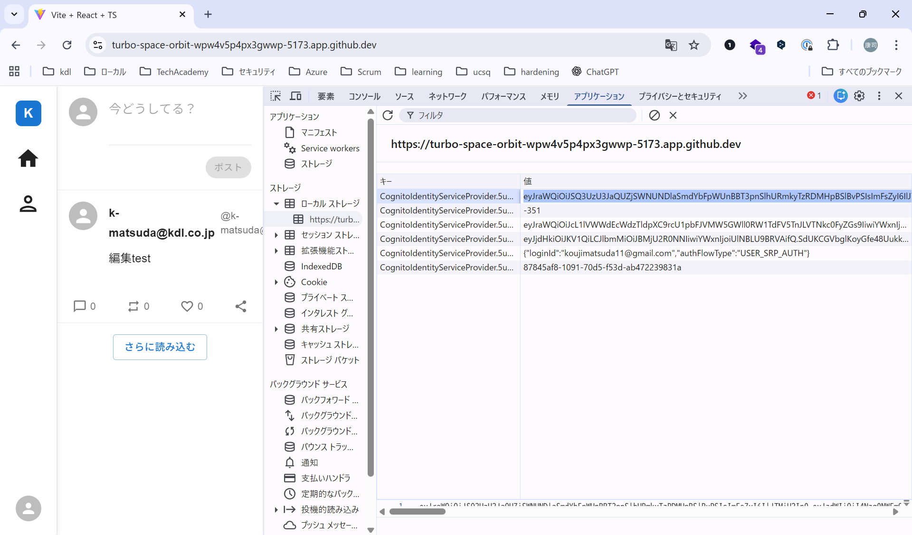
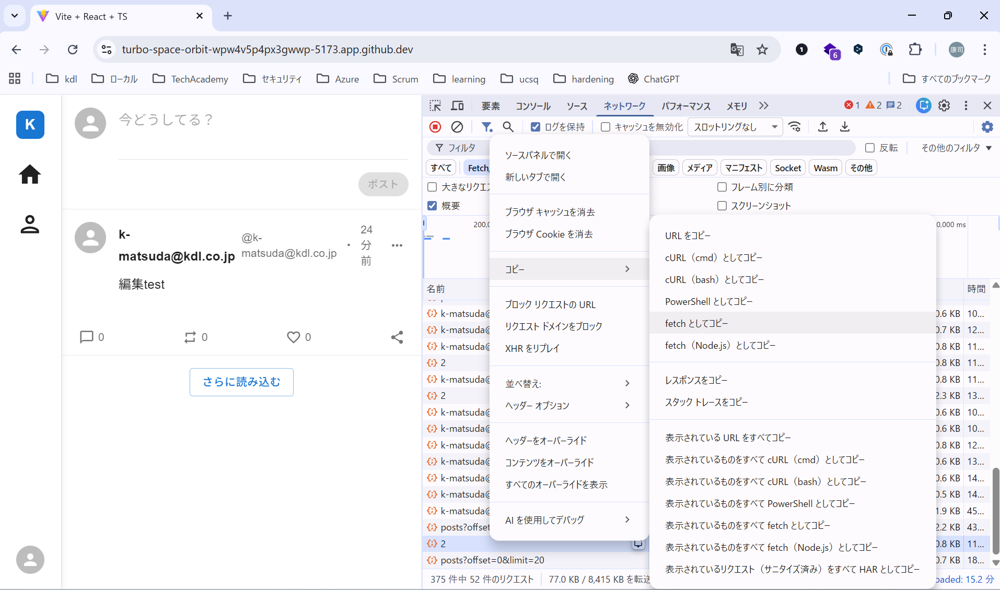
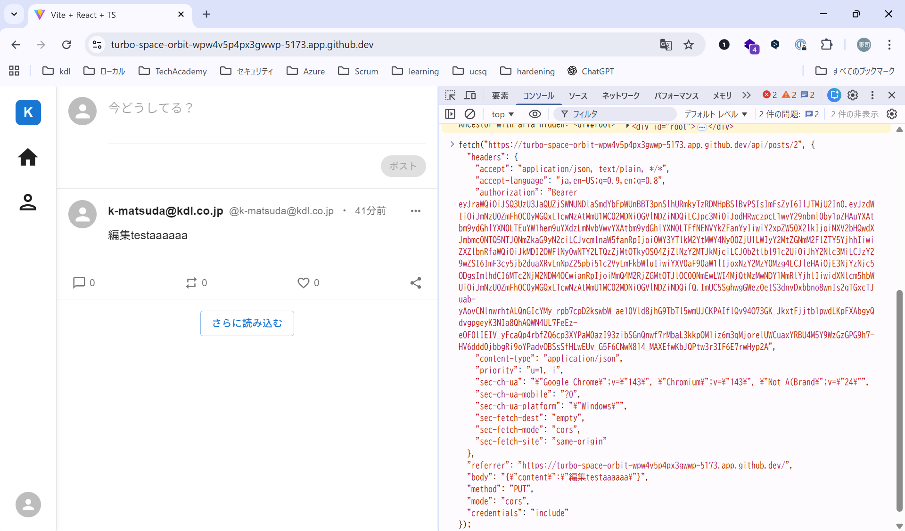
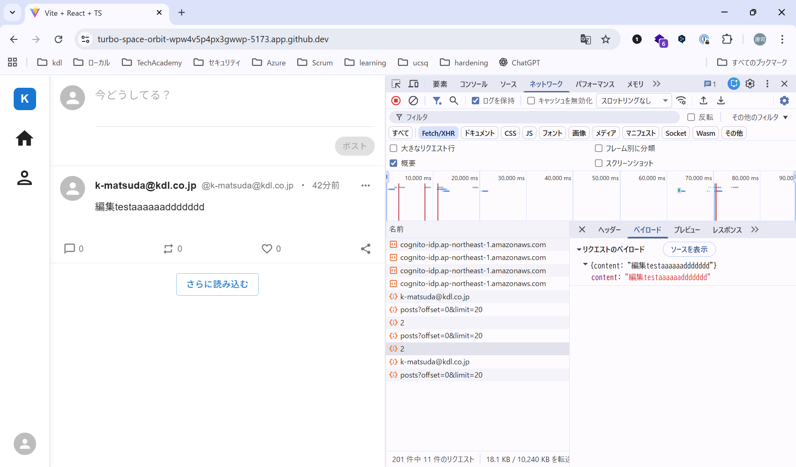
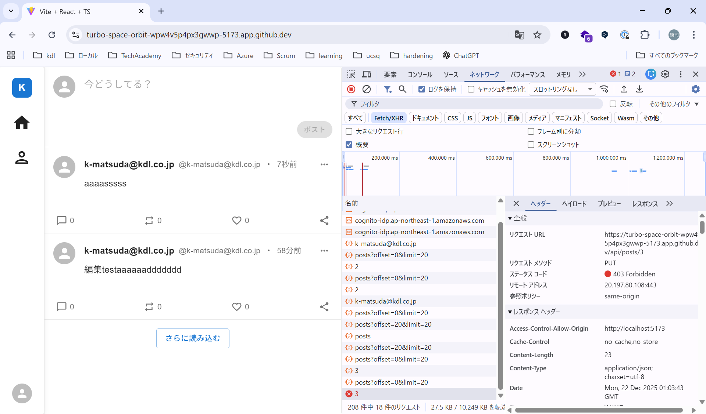

# 認可
この章は、認可を強化します。このアプリケーションでは、`authorization.md`に記載の通りの権限を想定しています。この権限通りの認可になっているかを確認します。

できれば、ユーザをもう1つ、合計2つ準備してください。メールアドレスはgmailでも大丈夫です。

なければ、以下のアカウントを使ってください。

```
k-matsuda@kdl.co.jp / password
```

認可の動作を確認するときには、必ず同じ権限で2つ以上のユーザを準備してください。

早速、認可の挙動をユーザを切り替えながらチェックしてみます。

## 投稿(Post)
まずは、投稿を行ってみます。投稿をしてみると、以下のようなリクエストが飛びます。ここにユーザ情報がありません。AuthorizationヘッダのAccessTokenに、ユーザ情報が含まれますので、そちらを使っているため、リクエストには、ユーザ情報がありません。つまり、他人の投稿をすることは、AccessTokenを取らなければ難しそうです。

``` 
POST /api/posts
{"content":"test"}
```

では、次に編集をしてみましょう。

``` 
PUT /api/posts/1
{"content":"編集test"}
```

この`1`の数字(連番になっているので各環境で異なります)は、おそらく投稿のIDを表しています。`./openapi.yml`にも記載がある通りです。

では、この数字を固定して、ユーザを変えて、リクエストしてみましょう。

※Codespaceの環境では、curlコマンドなどでリクエストを送信しづらいため、`Burp`や`ZAP`といったプロキシツールを使うことがお勧めです。以下で説明するのは、Chromeだけで完結する手順ですが、操作が手間であり、完全に再現できないことに注意してください。

### リクエストを改ざんして送る(Chrome開発者ツール利用版)
アプリケーションにChromeでアクセスして、Chromeの開発者ツールを開きます（F12もしくは、右クリックして`検証`を選択します）。

まず、別ユーザでログインしてAccessTokenを取得しておきます。別ユーザでログイン後、、Chromeの開発者ツールを開き、アプリケーションタブ->ローカルストレージ->https://...->キーにaccessTokenと書かれた行から、AccessTokenをコピーします。



次に、対象のユーザでログインして、投稿の編集を行います。開発者ツールのネットワークタブで、今送信したリクエストを選択し、右クリック->コピー->fetchとしてコピーを選択します。



コンソールタブを開いて、貼り付けます。



ここで、AuthorizationヘッダのBearerトークンのAccessTokenを先ほどコピーした別のユーザのAccessTokenに変更します。念のため、Bodyも変更して、Enterキーを押して実行してください。

最後に、再びネットワークタブを開き、リクエストが送られていることを確認します。



200になっていれば、 **認可失敗** です。別ユーザで編集ができてしまいました。

### 修正する
コードを見てみましょう。

`backend/src/services/PostService.ts:68`

``` typescript
  async updatePost(
    postid: any,
    content: string,
    user: User,
  ): Promise<PostDto> {
    const post = await this.repos.postRepository
      .createQueryBuilder('post')
      .leftJoinAndSelect('post.user', 'user')
      .leftJoinAndSelect('post.users', 'users')
      .where(`post.id = ${postid}`)
      .getOne();

    if (!post) {
      throw new Error(`Post:${postid} not found.`);
    }

    post.content = content;

    await this.repos.postRepository.save(post);
    return this.toDto(post, user.id);
  }
```

一見、よさそうに見えますが、DBアクセス前に認可していません。つまり、このレコードの編集することが可能かどうかのチェックがデータアクセス前に入っていません。そのため、本来アクセス権を持たない、他人が投稿を編集することができました。

では、実装してみます。`canBeUpdatedBy`メソッドは、実装済みのメソッドで、投稿とアクセスしてきたユーザのidが一致するかを確認しています。

``` typescript
  async updatePost(
    postid: number,
    content: string,
    user: User,
  ): Promise<PostDto> {
    // if not found, throw EntityNotFoundError
    const post = await this.repos.postRepository.findOneOrFail({
      relations:{ 
        user: true,
        users: true,
      },
      where: { id: postid },
    });

    if (!post.canBeUpdatedBy(user.id)) {
      throw new AuthorizationError(`User:${user.username} cannot update Post:${post.id}.`);
    }

    post.content = content;

    await this.repos.postRepository.save(post);
    return this.toDto(post, user.id);
  }
```

もう一度同じ手順を試してみます。403 Forbiddenが返ってくれば、修正できています。



## 課題:投稿の削除
投稿の削除についても、同様に認可の不備があります。探して修正してみましょう。

<details><summary>回答例</summary>

`backend/src/services/PostService.ts:90`

``` typescript
  async deletePost(
    postid: number,
    user: User,
  ): Promise<void> {
    // if not found, throw EntityNotFoundError
    const post = await this.repos.postRepository.findOneOrFail({
      relations:{ user: true },
      where: { id: postid },
    });

    if (!post.canBeDeletedBy(user.id)) {
      throw new AuthorizationError(`User:${user.username} cannot delete Post:${post.id}.`);
    }

    await this.repos.postRepository.remove(post);
  }

```

</details>

## 課題:その他の認可チェック
投稿の他に、いいね、プロフィール、アイコンにも登録、更新、削除、閲覧があります。それぞれ権限チェックしてみてください。特に、Authorizationヘッダを取って、ゲストユーザでチェックすることも忘れないようにしましょう。

<details><summary>回答例</summary>
たぶん、ないはずです。

</details>

