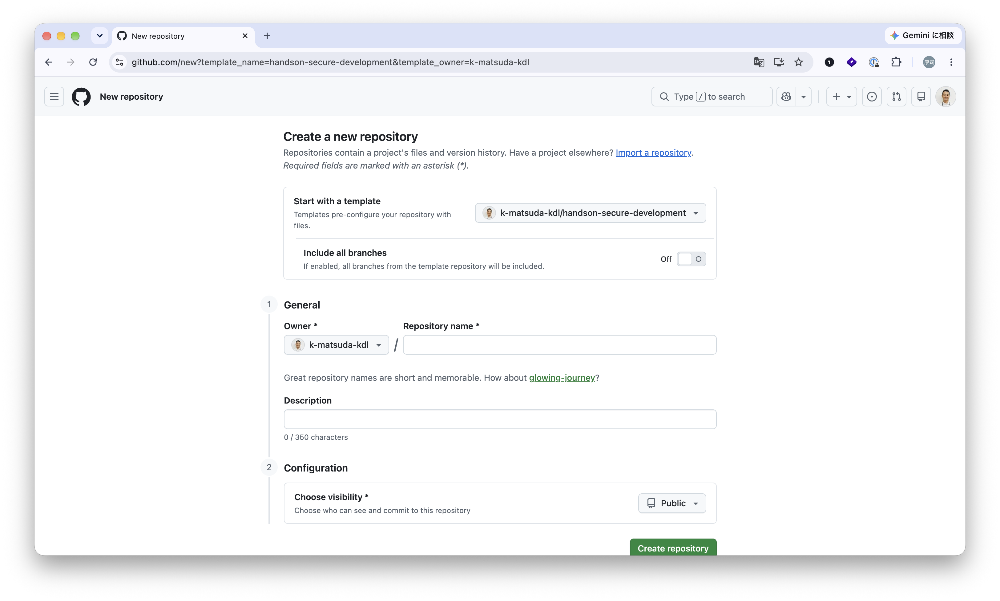
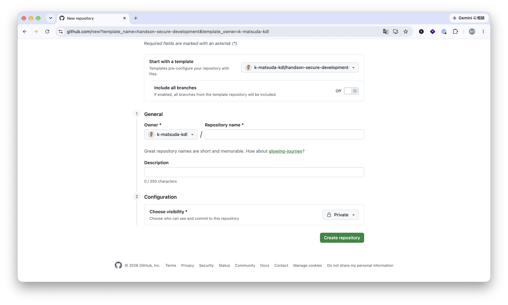
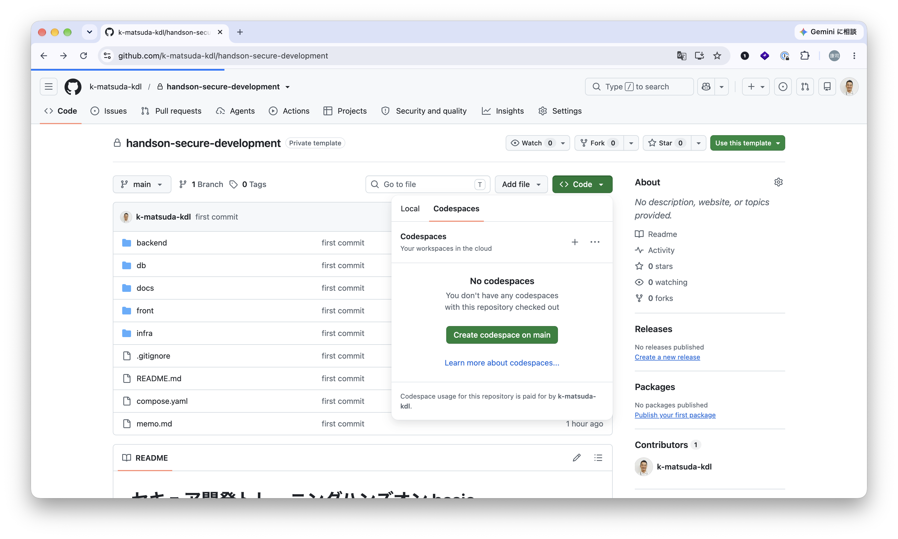
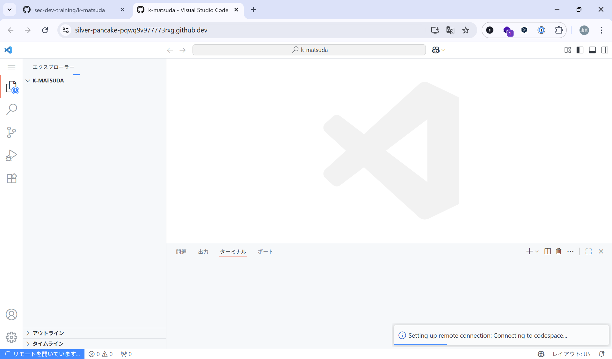
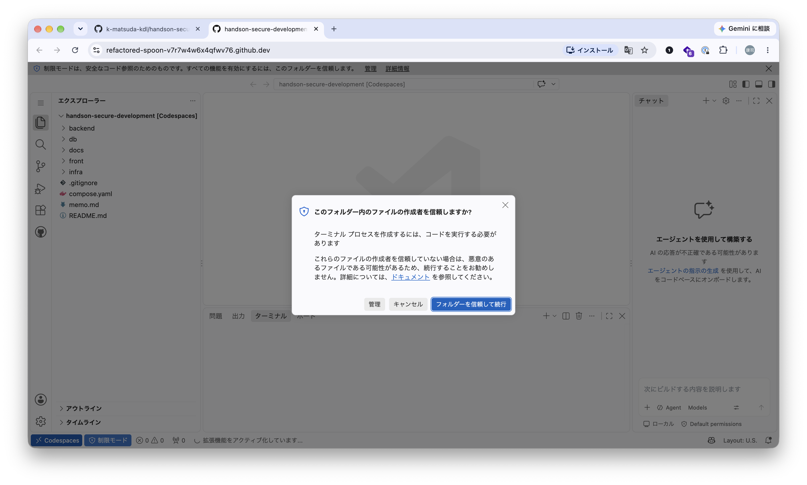
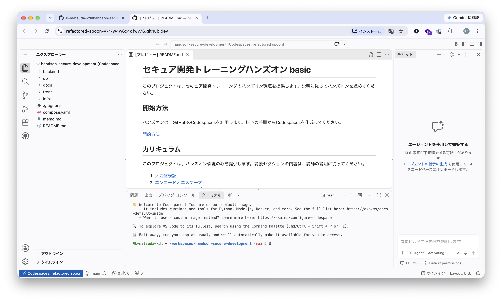
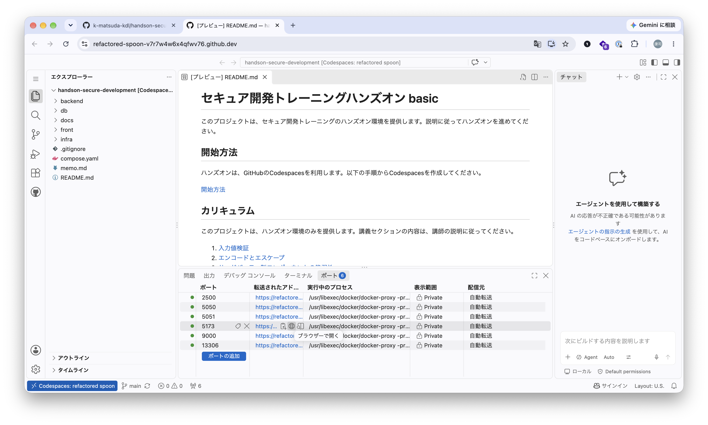
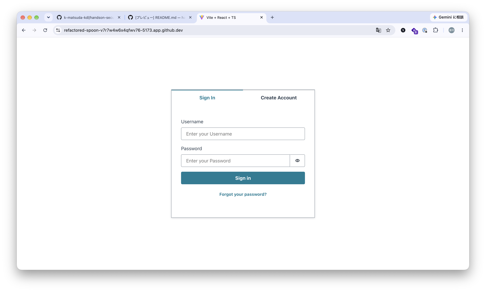
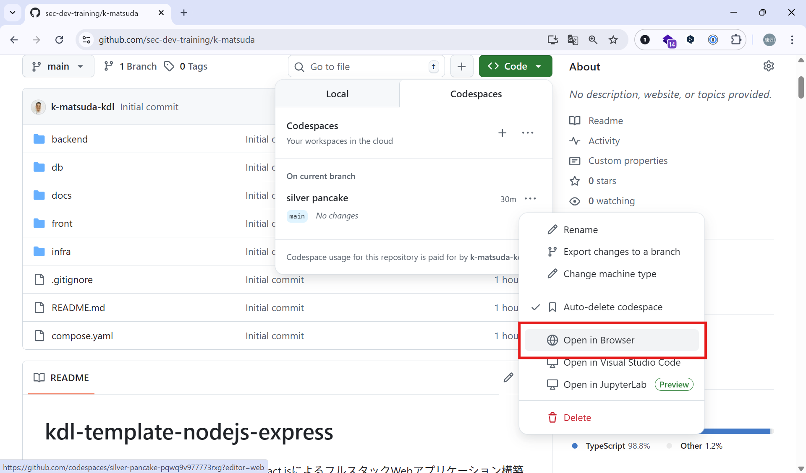

## 開始方法
### Codespacesの利用
このハンズオンでは、Codespacesを利用します。Codespacesについては、ご自身の利用枠をお使いいただきます。120 時間(2026/10/7 現在)の無料枠がありますが、すでに消化されている場合など、契約内容によってはお金がかかりますので、ご留意ください。

参考： [GitHub Codespaces の課金](https://docs.github.com/ja/billing/concepts/product-billing/github-codespaces)

なお、Codespacesを利用したくない場合は、ご自身のローカルPCでも可能です。

### リポジトリの作成
このハンズオンでは、テンプレートリポジトリから自身のリポジトリを作成して、そのリポジトリで受講をしていただきます。必ず、ご自身のオーガニゼーションにリポジトリを作成してください。

1. テンプレートリポジトリからリポジトリを作成する  
[テンプレートリポジトリ](https://github.com/new?template_name=handson-secure-development&template_owner=koujimatsuda11)

2. 下図の画面が開いたら、`Repository name`を入力します。好きな名前にしてください。

3. `Choose visibility`を確認し、問題なければ`Create Repositoy`で作成します。

### Codespacesを作成する
作成したリポジトリでCodespacesを立ち上げます。

1. 自身のリポジトリにアクセスして、`<>Code`から、`Create Codespace on main`をクリックしてCodespacesを立ち上げます。

2. Codespacesの立ち上げには、数分時間がかかります。少し待ちましょう。

3. 以下の画面が出たら「フォルダを信頼して続行」をクリックしてください。

4. 下図のような画面になれば、立ち上がりました。

※VSCodeをインストールされている場合は、ご自身のPCのVSCodeでも立ち上げることが可能です。

### サービスを立ち上げる
Codespaeceを起動すると、自動的に.devcontainerに定義されたコンテナが立ち上がっています。

1. URLにアクセスしてみます。`ポート`タブの`5173`ポートのURLにアクセスします。

2. 下図の画面が表示されれば、サービスが立ち上がり、アクセスできるようになりました。

### サービスを使ってみる
このサービスは、SNSのようなサービスです。自分の気持ちや今したことなどを投稿します。タイムラインには、通常他のユーザの投稿が表示されますが、今回は専用の環境なので作成したユーザの投稿のみしか表示されていないと思います。

では、サービスの使ってみて動作を確かめます。自由に触ってみてください

#### ユーザを作成する
1. ユーザを作成します。サービスにアクセスし、`Create Account`タブをクリックして指示に従って、ユーザを作成します

2. `Email`にはご自身のメールアドレスを入力してください。（届きません）

3. `ポート`タブの`9000`ポートのURLにアクセスします。

4. 仮想的にメールが受信されており、そのコードを取得して入力します。

4. 一連のユーザ登録は、`Magnito`を利用しています。

#### サインインして投稿する
ユーザを作成すると、サービスにサインインできるようになります。

1. サインインした後、`今どうしてる？`に投稿内容を入力してください。140文字以内で入力が可能です。なお、画像のアップロードには対応していません。

2. 投稿されたら、タイムラインに表示されます。

3. `･･･`アイコンをクリックすると、編集や削除を行います

4. `♡`アイコンをクリックすると、いいねができます

#### 自分のプロフィールを更新する
プロフィールメニューから自身のプロフィールが変更できます。また、自身のアイコンも変更できます

1. 左メニューの`プロフィール`にアクセスします

2. `プロフィールを編集`をクリックするとプロフィールの編集が行えます

3. 自身のアイコン画像の下の`鉛筆`アイコンをクリックすると画像をアップロードできます

#### ログアウトする
最後に左下に表示されている`email`をクリックすると`ログアウト`することができます

### Codespacesの再開
一定時間放置するとCodespacesは動作を停止します。再開するには、以下の手順を実施してください。

1. 自身のリポジトリにアクセスして、`<>Code`から`Codespaces`を選択します。すると、すでに作成したspaceがあるので、`･･･`メニューから`Open in Browser`を選択してください。

2. `ポート`タブから5173ポートのURLにアクセスするとサービスにアクセスできます。

